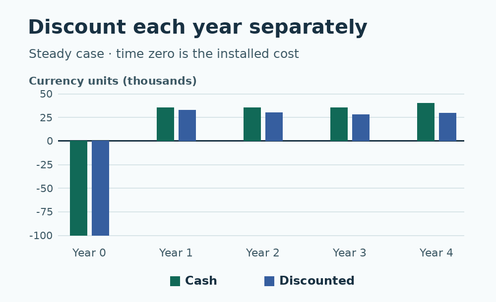

# Automation ROI calculator in Python

Compare the cash effects of an automation proposal against continuing the current process. Three fictional scenarios show straightforward savings, capacity that does not turn into cash, and a later rebuild that reverses payback. The project needs no equipment or dependencies.

[Full lesson at WIFA Robotics](https://wifarobotics.com/learn/automation-roi-calculator/)



## Get started

1. Install [Python 3.11 or newer](https://www.python.org/downloads/). On macOS or Linux, open Terminal and run `python3 --version`. On Windows, open PowerShell and run `py -3 --version`; substitute `py -3` for `python3` below. If your system only has `python`, check that it reports version 3.11 or newer.
2. Use **Code → Download ZIP** on GitHub, extract it, and open a terminal in the folder that contains `roi.py`. No pip installation is needed.
3. Run these commands one at a time.

```sh
python3 roi.py examples/steady.json
python3 roi.py examples/capacity-only.json
python3 roi.py examples/late-rebuild.json
python3 -m unittest discover -s tests -v
```

| Scenario | Final cash | NPV | Simple ROI | Discounted payback, first / sustained |
| --- | ---: | ---: | ---: | --- |
| Steady | 45,000.00 | 19,599.59 | 45.00% | Year 4 / year 4 |
| Capacity only | −71,000.00 | −76,452.09 | −71.00% | None / none |
| Late rebuild | 10,000.00 | −1,979.17 | 25.00% | Year 2 / none |

Exit 0 means a valid scenario was calculated, even when NPV is negative. Exit 2 means the input or arguments were invalid.

## Enter a case

Copy a JSON example. Use a single currency and today's purchasing power throughout. Use numbers without quotation marks, with no more than two decimal places.

- `initial_cost`: positive incremental installed cost at time zero. Include integration and commissioning here if paid at time zero.
- `real_discount_percent`: annual real discount rate in percent, from 0 to 100. Enter 8 for eight percent.
- `terminal_resale` and `terminal_removal`: nonnegative final receipts and costs. Both are applied in the last modeled year.
- `years`: one to 30 records in order. Each has `avoided_overtime`, `other_cash_savings`, `running_cost` and `one_time_cost`. Each field is a nonnegative amount relative to the current process. Put replacement or rebuild expenses in the year they occur.

Cash means a change in payments or receipts. Hours freed on a fixed payroll do not automatically cut wages. Keep that capacity in a separate operational record. If you monetize additional sales, use defensible incremental contribution after variable costs and evidence of demand. Do not also count the same hours as avoided overtime.

All post-installation flows occur at year end. The ledger discounts each cash flow and sums those present values including the initial cost. Simple ROI is final undiscounted net cash divided by initial cost, multiplied by 100. The payback columns give the first nonnegative year and the first year that stays nonnegative through the modeled horizon. Neither is a fractional-year estimate. Decisions are made before rounding.

## Troubleshooting

- **File not found:** use `ls` or `dir` to find `roi.py` and the `examples` directory.
- **Savings look too high:** compare the same volume, quality and period in both processes, and exclude fixed payroll that is still paid.
- **Positive simple ROI with negative NPV:** check when the savings occur and confirm that the annual real rate matches constant purchasing-power amounts.
- **Payback appears then disappears:** check later one-time costs and compare the two payback columns.

These figures are examples, not a quote or measured result. The model excludes tax, debt, inflation and risk probabilities. Validate the proposal using actual shift data, invoices, supplier quotes and the approved analysis assumptions before funding equipment. See [NIST Handbook 135](https://doi.org/10.6028/NIST.HB.135e2025) and [DOE economic analysis methodology](https://www.energycodes.gov/methodology) for present value and the limitations of simple payback. They are building-sector references; their mandated assumptions are not applied here.

The figures use the example ledgers. Install Pillow separately and make DejaVu Sans available if you want to run `python3 diagrams/draw.py` and regenerate the WebP files.
